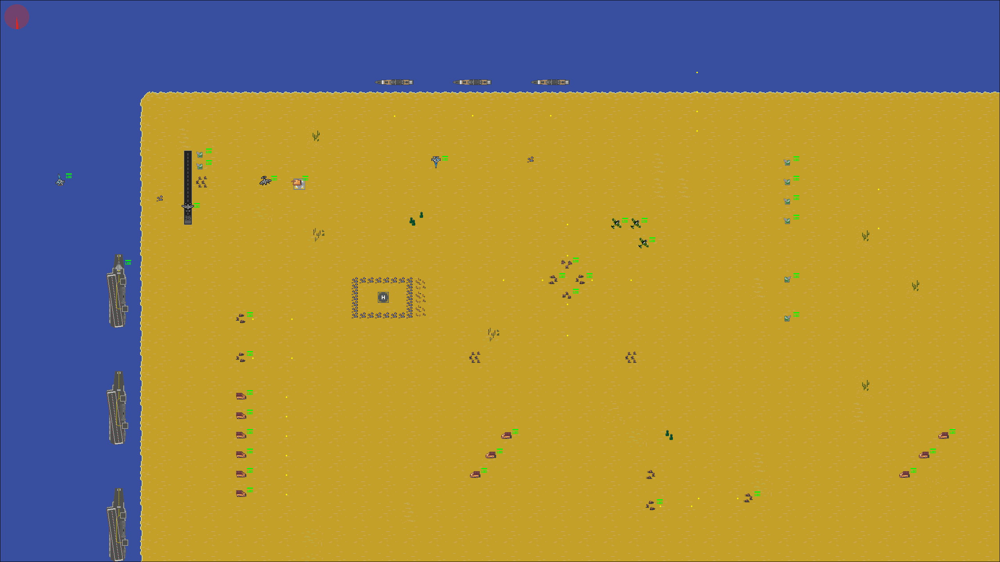

# 2D Game Engine in C++

A 2D game engine in modern C++17 with SDL2, built while following Pikuma's *C++ 2D Game Engine Development* course and later extended with my own memory and lifetime fixes. It features a custom Entity Component System (ECS), Lua scripting and Dear ImGui integration.



## Features

- **Entity Component System (ECS)** with data-oriented component pools, keeping components of the same type packed together in memory
- **Event system** for decoupled communication between systems (for example, collision events)
- **Asset store** for loading and managing textures, fonts and other resources
- **Collision system**
- **Animation system** for sprite-based animations
- **Lua scripting** via Sol, so game logic and level data can be defined in scripts without recompiling
- **Dear ImGui** integration
- **Logger** for engine messages and errors

## My improvements (after the course)

After finishing the course, I went back to the code and fixed several memory and lifetime problems:

- **Shutdown order:** textures and fonts were destroyed after the renderer and SDL had already shut down. Shutdown now runs in the reverse order of initialization, `TTF_Quit()` was added, and the raw SDL pointers start as `nullptr`. Verified with logging.
- **Virtual destructor in `System`:** systems were only deleted correctly because `std::make_shared` remembers the real type. The base destructor is now `virtual`, so deletion stays correct with any smart pointer.
- **AssetStore texture leak:** loading a texture with an id that already existed leaked the new texture, failed loads were stored silently as null, and `GetTexture` inserted empty entries for unknown ids. All three are fixed, with error logging.

**Known issues I'd tackle next**

- Entity IDs are reused without a generation counter, so a stale handle (for example, a projectile's target) can silently point to a new entity.
- The logger keeps every message in memory for the whole session.
- Fonts in the AssetStore still need the same fixes as textures.

## Tech

C++17 · SDL2 (SDL2_image, SDL2_ttf, SDL2_mixer) · Lua · Sol · Dear ImGui · MinGW-w64 (MSYS2 UCRT64) · Make

## Download and play

1. Go to the [Releases](../../releases) page and download the latest `.zip`.
2. Unzip it anywhere.
3. Run `gameengine.exe`.

**Controls**

| Key | Action |
|---|---|
| Arrow keys | Change direction (the player keeps moving in the chosen direction) |
| Space | Shoot |

## Build from source (Windows)

**Requirements**

- [MSYS2](https://www.msys2.org/) with the UCRT64 environment
- Install the compiler and libraries from the MSYS2 UCRT64 terminal:

```
pacman -S mingw-w64-ucrt-x86_64-gcc mingw-w64-ucrt-x86_64-make mingw-w64-ucrt-x86_64-SDL2 mingw-w64-ucrt-x86_64-SDL2_image mingw-w64-ucrt-x86_64-SDL2_ttf mingw-w64-ucrt-x86_64-SDL2_mixer mingw-w64-ucrt-x86_64-lua53
```

- Make sure `C:\msys64\ucrt64\bin` is in your `PATH`. If MSYS2 is installed somewhere else, update the SDL2 include path in the `Makefile` (or in `build.ps1`).

**Option A: Make**

```
mingw32-make build
mingw32-make run
```

| Command | What it does |
|---|---|
| `mingw32-make build` | Compiles the engine with a console window (useful for logs) |
| `mingw32-make release` | Compiles the engine without a console window |
| `mingw32-make run` | Runs `gameengine.exe` |
| `mingw32-make clean` | Deletes the executable |

**Option B: PowerShell script**

```
.\build.ps1
.\gameengine.exe
```

To save the full log (including errors) to a file: `.\gameengine.exe > log.txt 2>&1`

## Project structure

```
src/
  Game/         Main game loop and setup
  ECS/          Entity Component System core
  AssetStore/   Resource loading and management
  Logger/       Logging utilities
libs/           Third-party libraries (Dear ImGui, Sol, ...)
assets/         Textures, fonts, sounds and scripts
```

## Architecture

The engine follows an Entity Component System design:

- **Entities** are just IDs.
- **Components** are plain data (transform, sprite, rigid body, collider, animation...) stored in contiguous pools per component type.
- **Systems** hold the logic and act on every entity that has the components they require (for example, the movement system updates all entities with a transform and a rigid body).
- The **Registry** manages entities, component pools and systems. Entities created or killed during a frame are only added to or removed from systems at the start of the next update, so systems never see the entity list change while they iterate over it.

This keeps data and behavior separate and makes it easy to add new features by writing a new component and system.

## What I learned

This project taught me how the systems of a game engine work underneath, instead of relying on an existing engine. Designing the ECS, event system and asset store gave me a much clearer understanding of engine architecture and of how the pieces I use every day in Unity fit together. Going back afterwards to fix memory and lifetime bugs taught me to think about ownership first: who owns each resource, and when exactly it is destroyed.

## Credits

Built while completing the [C++ 2D Game Engine Development](https://pikuma.com/courses/cpp-2d-game-engine-development) course by Gustavo Pezzi at Pikuma.

Libraries: [SDL2](https://www.libsdl.org/), [Lua](https://www.lua.org/), [Sol](https://github.com/ThePhD/sol2), [Dear ImGui](https://github.com/ocornut/imgui).

## Author

**Ricard Peláez Corberó** — Game Programmer
[LinkedIn](https://www.linkedin.com/in/ricardpelaez) · [GitHub](https://github.com/ricardpelaezc)
